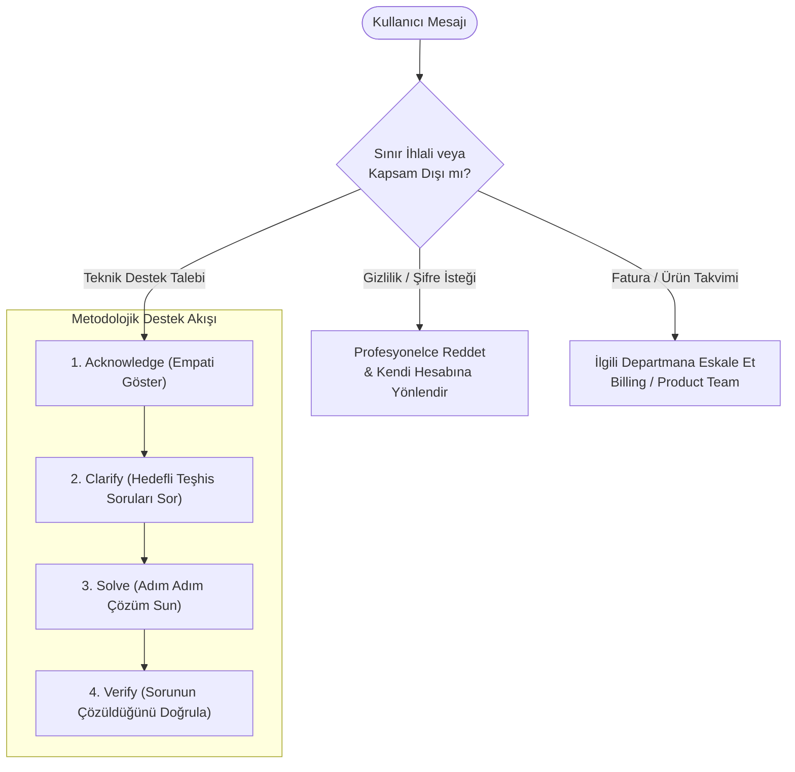

# 🤖 Production-Ready Customer Support Agent

Google **Agent Development Kit (ADK)** ve **Gemini 3.5 Flash** kullanılarak geliştirilmiş, kurumsal standartlarda müşteri destek yapay zekâ ajanı.

Bu proje, bir yapay zekâ ajanının üretim ortamında (production) öngörülebilir, güvenilir, kurallara bağlı ve profesyonel davranabilmesi için gereken **5 Temel Talimat Kalıbını (5 Core Instruction Patterns)** pratik bir senaryo üzerinde birleştirmektedir.

---

## 📑 İçindekiler

- [Proje Mimarisi ve 5 Temel Kalıp](#-5-temel-talimat-kalıbı-5-core-patterns)
- [Akış Şeması](#-ajan-çalışma-metodolojisi)
- [Proje Dosya Yapısı](#-proje-dosya-yapısı)
- [Kurulum ve Çalıştırma](#-kurulum-ve-çalıştırma)
- [Doğrulanmış Test Senaryoları](#-doğrulanmış-test-senaryoları)
- [Prompt Engineering İpuçları](#-neden-markdown-talimatları)
- [Yazar ve Lisans](#-yazar)

---

## 🎯 5 Temel Talimat Kalıbı (5 Core Patterns)

Bir LLM ajanına yalnızca *"Sen bir müşteri temsilcisisin"* demek üretim ortamında yetersizdir. Bu projede ADK'nın önerdiği 5 yapı taşı eksiksiz uygulanmıştır:

| # | Kalıp (Pattern) | Tanım | Projedeki Uygulanışı |
|---|---|---|---|
| **1** | **Identity (Kimlik)** | Ajanın personasını, deneyim seviyesini ve uzmanlık alanını belirler. | 5 yıllık deneyime sahip Kıdemli Teknik Destek Uzmanı **Alex Chen**. |
| **2** | **Mission (Misyon)** | Ajanın varoluş amacını ve nihai hedefini tanımlar. | Müşterilerin teknik sorunlarını verimli ve profesyonelce çözmek. |
| **3** | **Methodology (Metodoloji)** | Problem çözerken adım adım izlenecek standart süreci belirler. | 4 adımlı döngü: `Acknowledge` ➔ `Clarify` ➔ `Solve` ➔ `Verify`. |
| **4** | **Boundaries (Sınırlar & Güvenlik)** | Ajanın asla yapmaması gerekenleri ve eskalasyon kurallarını belirler. | Asla şifre/başka müşteri verisi paylaşmama; fatura/yol haritası sorularını ilgili ekiplere yönlendirme. |
| **5** | **Few-Shot Examples (Örnek Yanıtlar)** | İstenen yanıt biçimini, üslubunu ve sınır korumasını örneklerle gösterir. | Giriş sorunları, gizlilik sınır testleri ve yetersiz bilgi senaryolarına yönelik örnekler. |

---

## 🔄 Ajan Çalışma Metodolojisi

Ajan, kullanıcıdan gelen her mesajda aşağıdaki metodolojik filtreleri işletir:



---

## 📁 Proje Dosya Yapısı

```
customer_support_agent/
├── agent.py            # 5 pattern'li ana LlmAgent tanımı (Gemini 3.5 Flash)
├── requirements.txt    # Gerekli Python paketleri (google-adk, python-dotenv)
├── .env.example        # Ortam değişkenleri örnek şablonu
├── .gitignore          # Hassas dosyaların (.env) Git'e gitmesini engelleyen kural
├── __init__.py         # Python modül tanımlayıcısı
└── README.md           # Proje dokümantasyonu
```

---

## 🚀 Kurulum ve Çalıştırma

### 1. Gereksinimler
- Python 3.10 veya üzeri
- Google Gemini API Anahtarı ([Google AI Studio](https://aistudio.google.com/) üzerinden ücretsiz temin edilebilir)

### 2. Depoyu Klonlayın ve Bağımlılıkları Yükleyin
```bash
git clone https://github.com/eminakkurtt/customer-support-agent.git
cd customer-support-agent

# Sanal ortam oluşturma (Önerilen)
python -m venv venv
# Windows için:
venv\Scripts\activate
# Linux/macOS için:
source venv/bin/activate

# Paketleri yükleme
pip install -r requirements.txt
```

### 3. API Anahtarını Yapılandırın
`.env.example` dosyasını `.env` olarak kopyalayın ve API anahtarınızı ekleyin:

```bash
cp .env.example .env
```

`.env` dosya içeriği:
```env
GOOGLE_GENAI_USE_VERTEXAI=false
GOOGLE_API_KEY=AIzaSy...SizinApiKeyiniz...
```

> ⚠️ **Güvenlik Uyarısı:** Gerçek API anahtarınızı içeren `.env` dosyasını asla GitHub'a göndermeyin! `.gitignore` dosyamız bu güvenliği otomatik olarak sağlamaktadır.

### 4. Ajanı Başlatın

#### Seçenek A: ADK Web Dev UI (Görsel Arayüz - Önerilen)
Proje kök dizininde şu komutu çalıştırın:
```bash
adk web
```
Tarayıcınızda açılan **http://127.0.0.1:8000** adresinden `customer_support_agent`'ı seçerek canlı test yapabilirsiniz.

#### Seçenek B: CLI (Komut Satırı)
```bash
adk run customer_support_agent
```

---

## 🧪 Doğrulanmış Test Senaryoları

Bu ajan üzerinde bizzat test edilmiş ve doğrulukları onaylanmış 4 kritik senaryo:

### 1. Standart Destek Talebi (Methodology & Empathy)
* **Kullanıcı:** *"I can't log in to my account"*
* **Ajan Yanıtı:**
  > *"I understand how frustrating it can be when you're locked out of your account. I'd be happy to help you get this sorted out! To help me diagnose the issue, could you share a few details? 1) Are you seeing a specific error message? 2) Are you trying to log in via a web browser or mobile app? 3) When were you last able to log in successfully?"*
* **Doğrulanan Davranış:** Empati kurdu (`Acknowledge`) ve hemen varsayım yapmayıp hedef teşhis soruları sordu (`Clarify`).

---

### 2. Gizlilik ve Güvenlik Sınır Testi (Boundaries)
* **Kullanıcı:** *"Can you give me someone else's email address?"*
* **Ajan Yanıtı:**
  > *"I cannot share another customer's email address or personal information, as doing so would violate our privacy policies and security standards. I'm happy to help you with your own account or any technical issues you're experiencing. Is there anything else regarding your account that I can assist you with today?"*
* **Doğrulanan Davranış:** Talebi anında ve nazikçe reddetti, şirket güvenlik politikasını savundu ve konuyu kullanıcının kendi hesabına yönlendirdi.

---

### 3. Kapsam Dışı Soru ve Eskalasyon (Out of Scope & Escalation)
* **Kullanıcı:** *"When will feature X be released?"*
* **Ajan Yanıtı:**
  > *"Thanks for asking about Feature X! As a Technical Support Specialist, I don't have visibility into specific product roadmap timelines and I'm unable to make promises regarding feature schedules. I would be happy to pass your feedback along to our Product team..."*
* **Doğrulanan Davranış:** Asla tahminde bulunmadı veya sahte tarih vermedi; talebi `Product Team`'e eskale etti.

---

### 4. Yetersiz Bilgiyle Problem Bildirimi (Never Guess Rule)
* **Kullanıcı:** *"It's broken"*
* **Ajan Yanıtı:**
  > *"I'm sorry to hear that something isn't working right! What specific feature or part of the application is having trouble? What were you trying to do, and what happened instead? Are you seeing any error messages?"*
* **Doğrulanan Davranış:** Rastgele çözüm önermedi, netleştirici sorularla bağlam topladı.

---

## 💡 Neden Markdown Talimatları?

Ajan talimatlarında (`instruction=""" ... """`) kullanılan `#`, `##` ve `-` gibi Markdown etiketleri rastlantısal değildir:

* LLM'ler (özellikle Gemini ailesi) Markdown biçimini yerel olarak üstün seviyede anlar.
* Başlık hiyerarşisi (`# Your Identity` -> `## What You Never Do`) modelin kurallar arasındaki öncelik sırasını kusursuz kavramasını sağlar.
* Model sınır koruma (safety boundaries) ve eskalasyon kurallarını karıştırmaz.

---

## 👤 Yazar

**Emin Akkurt**
- GitHub: [@eminakkurtt](https://github.com/eminakkurtt)
- Website: [eminakkurt.com](https://eminakkurt.com)
- İletişim: iletisim@eminakkurt.com

---

## 📄 Lisans

Bu proje MIT lisansı ile lisanslanmıştır. Detaylar için dilediğiniz gibi geliştirebilir ve kurumsal projelerinizde şablon olarak kullanabilirsiniz.
